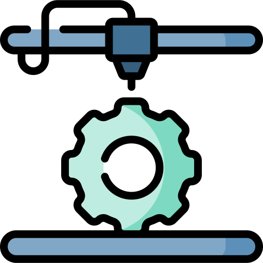

# Ajustes Hardware

Vamos a desarrollar los distintos ajustes relacionados con los componentes mecánicos y electrónicos (Hardware) de cualquier impresora. Estos ajustes implican la modificación de ciertos valores en el Firmware de la impresora.

En esta primera parte nuestro objetivo es conseguir configurar nuestra máquina para que se mueva correctamente, con velocidades y precisiones reales. Posteriormente se necesitará realizar procesos de calibración y ajustes más precisos.

Para la realización de muchas de estas pruebas se necesita utilizar ['Pronterface'](https://www.pronterface.com/) para comunicar con la impresora. 
* Cada impresora tiene definida su velocidad de transmisión (baudios) en el firmware y debe coincidir con la elegida en **Pronterface** para poder comunicar con ella. 
* Algunas impresoras, como es el caso de la Artillery Genius necesitan modificaciones HW o desconectar componentes HW para poder establecer la comunicación
* Otras como la Creality Ender 3 tiene bloqueado el Bootloader y hay que desbloquearlo previamente para poder modificar el Firmware.

Puedes encontrar más información de cómo [Conectar la impresora 3D al PC](./bitacora/conectar-pc.md).
