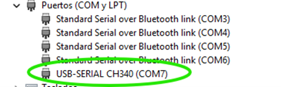

# Para qué se necesita

Se necesita conectar la impresora a un ordenador ya sea para grabar un nuevo Firmware o bien para controlar la impresora, ya sea para hacer pruebas o reprogramaciones desde el programa Pronterface.

Para conectar la impresora a un ordenador hay que conocer el **puerto de conexión** y la **velocidad de transmisión** (establecida en el firmware y habitualmente es 250000 baudios).

# Determinar el puerto de conexión (Windows)

En el ordenador abriremos el Administrador de Dispositivos y buscaremos el apartado **Puertos (COM y LPT)**.

Al conectar la impresora al ordenador se conecta a un puerto COM, busca el que tenga una conexción USB-SERIAL CH340 (COMx) o similar, tal y como se muestra en la imagen.

# Conexión con Pronterface (puerto y velocidad de transmisión)

