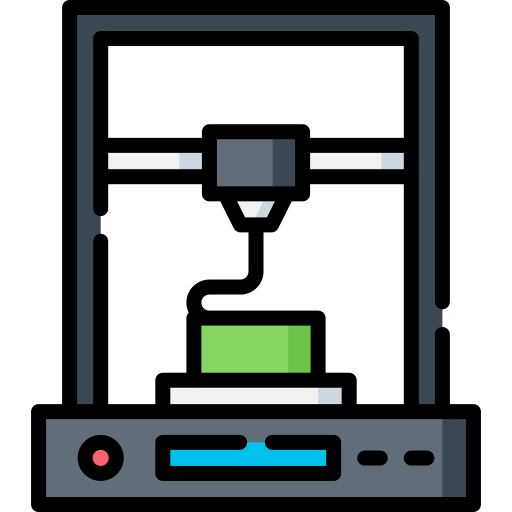

# Introducción

La calibración de una impresora 3D es un proceso sistemático cuyo objetivo es garantizar que todos los elementos **—mecánicos, electrónicos y de software—** trabajen de forma coherente para obtener piezas precisas, repetibles y de buena calidad. 

No se trata de un único ajuste, sino de una serie de pasos ordenados que permiten entender la impresora, detectar sus límites y adaptar su comportamiento a los materiales y objetivos de impresión.

Este proceso se divide en tres módulos principales. 

# Ajustes Hardware



# Parametrizar Impresora



# Perfiles del Laminador



Juntos, estos módulos proporcionan una base sólida para imprimir con mayor control, eficiencia y calidad.

# Licencia

MIT License

Copyright (c) 2026 Juan Pedro Perianes

Permission is hereby granted, free of charge, to any person obtaining a copy
of this software and associated documentation files (the "Software"), to deal
in the Software without restriction, including without limitation the rights
to use, copy, modify, merge, publish, distribute, sublicense, and/or sell
copies of the Software, and to permit persons to whom the Software is
furnished to do so, subject to the following conditions:

The above copyright notice and this permission notice shall be included in all
copies or substantial portions of the Software.

THE SOFTWARE IS PROVIDED "AS IS", WITHOUT WARRANTY OF ANY KIND, EXPRESS OR
IMPLIED, INCLUDING BUT NOT LIMITED TO THE WARRANTIES OF MERCHANTABILITY,
FITNESS FOR A PARTICULAR PURPOSE AND NONINFRINGEMENT. IN NO EVENT SHALL THE
AUTHORS OR COPYRIGHT HOLDERS BE LIABLE FOR ANY CLAIM, DAMAGES OR OTHER
LIABILITY, WHETHER IN AN ACTION OF CONTRACT, TORT OR OTHERWISE, ARISING FROM,
OUT OF OR IN CONNECTION WITH THE SOFTWARE OR THE USE OR OTHER DEALINGS IN THE
SOFTWARE.

